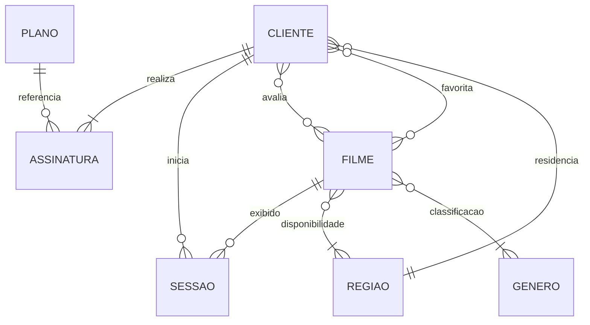

# Modelo conceitual — versão de 15/11/2026

O modelo conceitual descreve as entidades, os atributos e os relacionamentos do sistema de streaming, com base nos requisitos do problema e nas dez consultas obrigatórias. O diagrama em Mermaid apresenta os relacionamentos em notação alternativa ao [diagrama conceitual](modelo_conceitual.png). O esquema relacional e o DDL correspondem a etapas distintas da modelagem.

## Entidades e atributos

As tabelas a seguir apresentam as entidades e seus atributos. Cada `id` é o identificador da respectiva entidade.

| Entidade | Atributos |
| --- | --- |
| Cliente | **id**, nome completo, email, data de nascimento, data de cadastro |
| Assinatura | **id**, data início, data término |
| Plano | **id**, nome, valor mensal, quantidade dispositivos, qualidade máxima |
| Região | **id**, nome, país |
| Sessão | **id**, data, h. início, duração, dispositivo, qualidade |
| Filme | **id**, título, ano lançamento, duração, classificação indicativa, produtora, idioma original, sinopse |
| Gênero | **id**, tipo |

| Relacionamento com atributos | Atributos |
| --- | --- |
| Avalia (Cliente–Filme) | nota, data |
| Favorita (Cliente–Filme) | data |

## Diagrama equivalente

A representação abaixo apresenta os relacionamentos, enquanto os atributos estão nas tabelas anteriores. Os rótulos descrevem a função de cada relacionamento denominado “Contém” no diagrama conceitual. Os limites mínimos e máximos de participação estão detalhados na tabela de cardinalidades.

## Cardinalidades dos relacionamentos

A coluna de participação informa quantas ocorrências do relacionamento cada instância da entidade pode ter. Esses limites estão expressos textualmente, independentemente da posição dos símbolos na notação Mermaid.

| Relacionamento | Participação de uma entidade | Participação da outra entidade |
| --- | --- | --- |
| Realiza | Cliente: 1 a N assinaturas | Assinatura: exatamente 1 cliente |
| Contém (Assinatura–Plano) | Assinatura: exatamente 1 plano | Plano: 0 a N assinaturas |
| Pertence | Cliente: exatamente 1 região | Região: 0 a N clientes |
| Inicia | Cliente: 0 a N sessões | Sessão: exatamente 1 cliente |
| Contém (Sessão–Filme) | Sessão: exatamente 1 filme | Filme: 0 a N sessões |
| Avalia | Cliente: 0 a N filmes | Filme: 0 a N clientes |
| Favorita | Cliente: 0 a N filmes | Filme: 0 a N clientes |
| Contém (Filme–Região) | Filme: 1 a N regiões | Região: 0 a N filmes |
| Contém (Filme–Gênero) | Filme: 1 a N gêneros | Gênero: 0 a N filmes |

## Decisões representadas e justificativas

- Cliente possui pelo menos uma assinatura no histórico. Isso não exige que ela esteja vigente hoje: clientes com assinaturas encerradas continuam cadastrados.
- Assinatura tem identidade própria para permitir períodos distintos do mesmo cliente no mesmo plano, inclusive retorno após uma troca.
- Sessão tem identidade própria: reassistir ao mesmo filme gera uma nova ocorrência.
- Cada cliente tem uma única região de residência; Região possui nome e país. Adota-se uma região pertencente a um único país para obter o país do cliente sem duplicação.
- Disponibilidade do catálogo e consumo são fatos distintos: Filme–Região registra disponibilidade; Sessão registra consumo.
- Um filme pode ter vários gêneros. Na soma por gênero, seus minutos entram em cada gênero associado; a soma desses grupos pode superar o tempo total do cliente.
- Nota pertence a Avalia, e a data em Favorita representa quando a associação atual foi criada.
- Chaves estrangeiras serão definidas no esquema relacional, não acrescentadas ao modelo conceitual.

## Regras propostas para consolidar na próxima etapa

As regras a seguir complementam o modelo conceitual e representam propostas para consolidação no esquema relacional. São decisões de modelagem adicionais aos requisitos explícitos do enunciado.

1. Assinatura: término ausente indica período aberto; quando preenchido, deve ser posterior ao início. Adotar intervalos de vigência [início, término), sem sobreposição para um mesmo cliente. Uma assinatura futura aberta não torna o cliente ativo antes do início.
2. Cliente ativo: possui assinatura vigente na data de referência.
3. Avaliação: uma avaliação atual por par cliente/filme; nota de 1 a 5. Alterar a nota atualiza a ocorrência, sem exigir histórico de notas.
4. Favorito: no máximo uma associação atual por par cliente/filme. Remover desfaz a associação; favoritar novamente cria uma nova data.
5. Duração de sessão e filme: explicitar unidade em minutos. Quantidade de dispositivos em Plano significa máximo permitido simultaneamente.
6. Consumo regional: proposta de usar a região de residência e assumir que ela não muda no escopo acadêmico. Se mudanças de residência precisarem preservar a região histórica das sessões, o modelo terá de armazenar essa informação.
7. Definir e-mail único, limites de qualidade de reprodução e exigência de assinatura vigente/disponibilidade regional para novas sessões.
8. Definir se preço e limites de Plano são constantes no escopo. O modelo não guarda versões históricas desses atributos.
9. Fixar interpretação de “último mês” e “último trimestre” e usar data de referência controlada na demonstração.
10. Consulta 5: decidir se as sessões dos títulos disponíveis em Y são contadas globalmente ou somente para clientes de Y.
11. Consulta 7: a média do máximo permitido por plano é o próprio limite quando a definição do plano é fixa. Definir o resultado para planos sem clientes ativos.

## Cobertura das dez consultas

| Consulta | Informações disponíveis |
| --- | --- |
| 1 — catálogo regional | Filme–Região e título |
| 2 — favoritos por data | Cliente–Favorita–Filme e data |
| 3 — gênero e média de nota | Filme–Gênero e Avalia.nota |
| 4 — filmes sem sessões no período | Filme–Sessão e data/hora |
| 5 — sessões e minutos dos títulos disponíveis em Y | Filme–Região, Sessão e duração; interpretação regional pendente |
| 6 — horas por gênero do cliente | Cliente–Sessão–Filme–Gênero; documentar contagem em vários gêneros |
| 7 — ativos por plano e limite de dispositivos | Assinatura, vigência e Plano.quantidade dispositivos |
| 8 — ranking regional do último mês | Cliente–Região, Sessão, Filme e duração; hipótese de residência fixa pendente |
| 9 — percentual de qualidade por cliente/período | Sessão.qualidade, cliente e data/hora |
| 10 — mudanças de plano no trimestre | Assinatura, cliente, plano e datas; comparar períodos consecutivos e planos diferentes |

## Próxima etapa

Construir o esquema relacional em texto: relações, atributos, chaves primárias e estrangeiras, unicidade e nulabilidade. Converter os relacionamentos N:N em relações associativas e verificar 1FN, 2FN e 3FN. Resolver as regras pendentes antes do DDL MySQL. A implementação ainda não começou.

